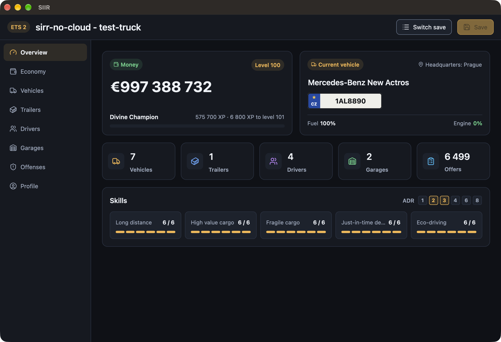
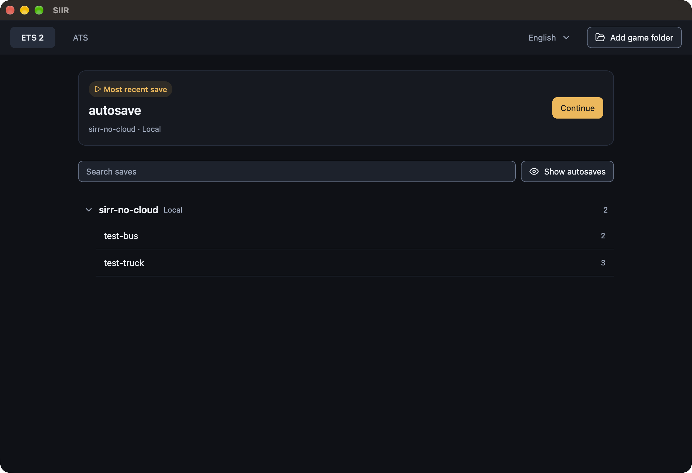
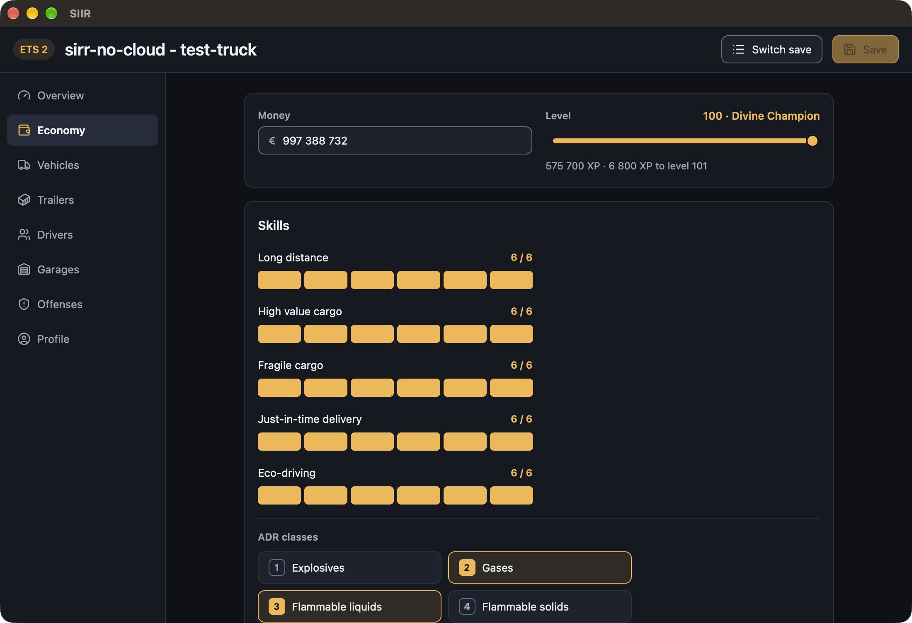
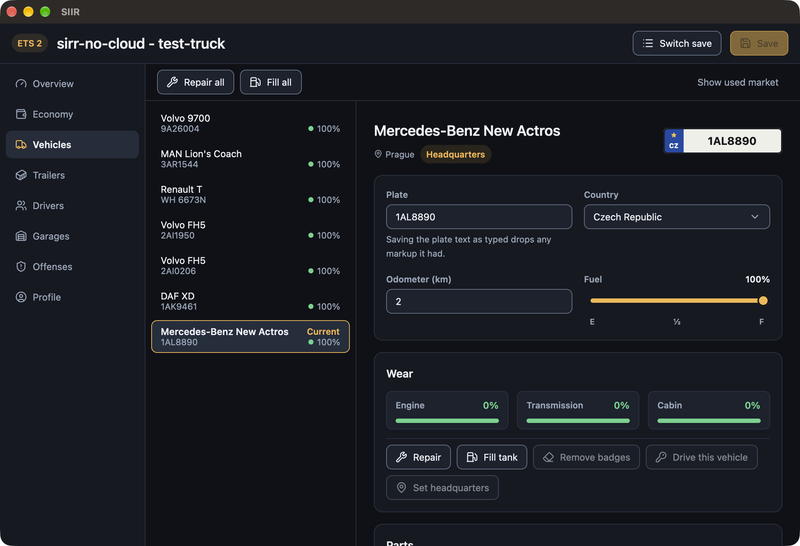
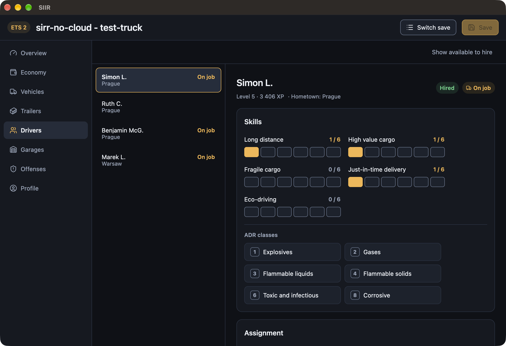
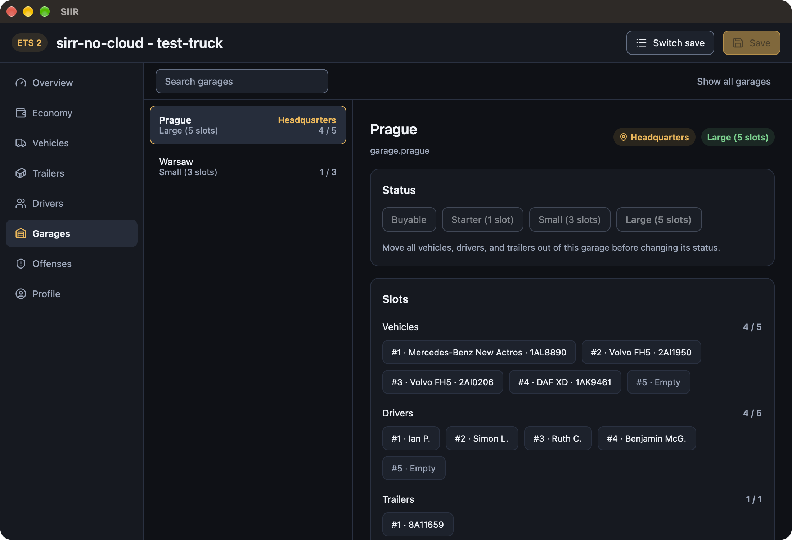
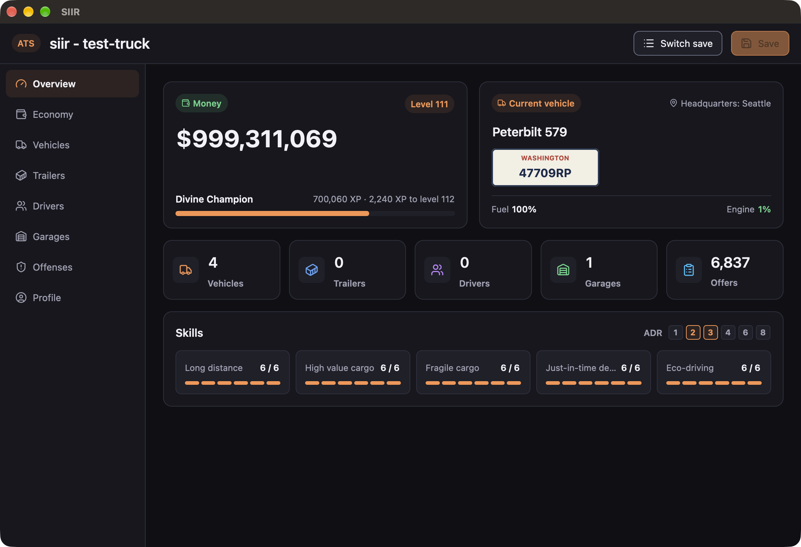

# SIIR

> [!WARNING]
> SIIR is in early development. Features are missing, things will change, and a
> bug can damage a save. Back up your profile before you edit it.

SIIR reads, edits, and writes the SII files of SCS Software's Euro Truck
Simulator 2 and American Truck Simulator, and ships a desktop app that edits
their saves.

It is an unofficial tool, not affiliated with or endorsed by SCS Software.

## Screenshots



| | |
|---|---|
|  |  |
|  |  |
|  |  |

## Download

Get the latest build from the
[Codeberg releases](https://codeberg.org/viniciusdof/siir/releases) or the
GitHub mirror's releases: a `.dmg` for macOS, an `.exe` for Windows, and an
AppImage for Linux. The builds are not signed yet; each release explains how to
open them the first time.

## Build from source

The toolchain is pinned with [mise](https://mise.jdx.dev/) and the commands
live in the `Justfile`:

```sh
mise trust
mise install
just setup
just gui
```

`just ci` is the full gate (format, Clippy, tests, docs, and the dependency
audit). `just` shows every command, including the release and bundle
recipes.

The app is built on [GPUI Kit](https://gpui-kit.com/); its
[installation guide](https://gpui-kit.com/docs/installation) lists the native
toolchain each OS needs

## Crates

| Crate | Role |
|---|---|
| `siir` | the SII format: plain text, `ScsC`, and `BSII` in; plain text out, with untouched values kept byte for byte |
| `siir-save` | the save model, the edit commands, profiles, config, and the game catalog |
| `siir-gui` | the desktop app, built on GPUI |

## License

SIIR is licensed under the [MIT license](LICENSE).

The app icon is the [OpenMoji](https://openmoji.org/) "articulated lorry"
emoji by Ronja Bäurlen, licensed under
[CC BY-SA 4.0](https://creativecommons.org/licenses/by-sa/4.0/); see
`packaging/icons/README.md`.
